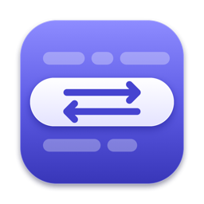
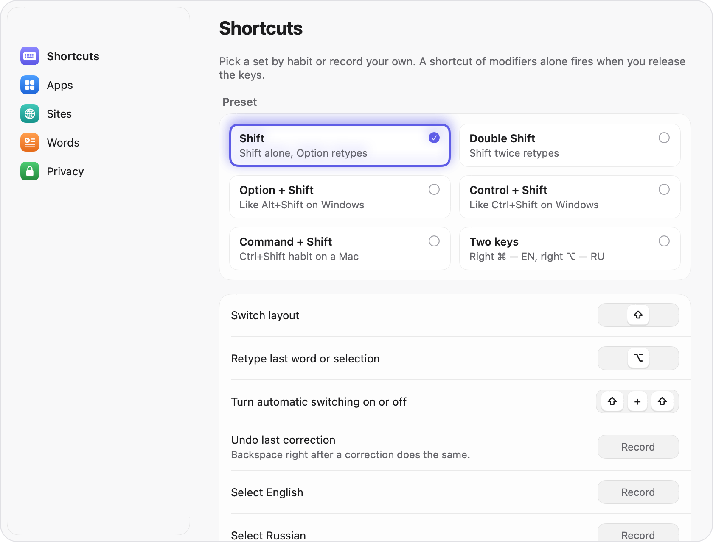

<p align="center">
  
</p>

<h1 align="center">Perekey</h1>

<p align="center">
  Бесплатный переключатель раскладки для macOS с открытым кодом и голосовым вводом.<br>
  Набрали <code>ghbdtn</code> вместо <code>привет</code>? Perekey исправит сам или по нажатию Option. Или скажите фразу — текст встанет у курсора.
</p>

<p align="center">
  <a href="https://github.com/tlgnkl/perekey/releases/latest/download/Perekey.dmg"></a>
</p>

<p align="center">
  <a href="https://github.com/tlgnkl/perekey/releases/latest"></a>
  
  
  <a href="LICENSE"></a>
</p>

<p align="center">
  <a href="https://tlgnkl.github.io/perekey/">Сайт</a> ·
  <a href="CHANGELOG.md">Что нового</a> ·
  <a href="https://github.com/tlgnkl/perekey/releases">Все выпуски</a> ·
  <a href="README.md">English</a>
</p>

<p align="center">
  <picture>
    <source media="(prefers-color-scheme: dark)" srcset="docs/images/hint-corrected-dark.png">
    
  </picture>
</p>

## Установка

1. [Скачайте `Perekey.dmg`](https://github.com/tlgnkl/perekey/releases/latest/download/Perekey.dmg)
   из последнего выпуска.
2. Откройте образ и перетащите Perekey в «Программы».
3. Запустите Perekey из «Программ».
4. Разрешите «Универсальный доступ» и «Мониторинг ввода», когда Perekey
   попросит. Без них он не видит нажатия и не может заменить слово.

Нужна macOS 14 или новее, Apple Silicon или Intel. Голосовой ввод,
расшифровки и запись созвонов требуют Apple Silicon и macOS 15 или новее; на
другом Mac Perekey переключает раскладку как раньше, а вкладка «Голос»
объясняет, почему голос выключен.

Или через Homebrew:

```sh
brew install --cask tlgnkl/tap/perekey
```

> [!IMPORTANT]
> Сборки пока без подписи Apple, поэтому macOS не даст запустить Perekey
> с первого раза.
> - **macOS 15 и новее:** откройте Perekey, закройте предупреждение, затем
>   откройте «Системные настройки» → «Конфиденциальность и безопасность»
>   и нажмите **«Всё равно открыть»**.
> - **macOS 14:** в «Программах» нажмите на Perekey с Control, выберите
>   **«Открыть»**, затем ещё раз **«Открыть»**.

**Обновления.** Perekey раз в день проверяет новую версию и спрашивает перед
установкой. Изменения каждого выпуска — в [CHANGELOG.md](CHANGELOG.md) и на
[странице выпусков](https://github.com/tlgnkl/perekey/releases). Рядом с каждым
образом лежит файл `.sha256`: `shasum -a 256 -c Perekey-<версия>.dmg.sha256`.

## Что умеет

- **Перенабор по сочетанию.** Option (или любое сочетание) перенабирает
  последнее слово или выделение в другой раскладке. Повторное нажатие
  возвращает как было.
- **Автопереключение.** Языковая модель внутри приложения решает в конце
  каждого слова. Один Backspace сразу после замены отменяет её, и Perekey
  запоминает слово: подсказка у курсора говорит об этом и предлагает «Забыть».
- **Опечатки.** Опечатки в одну клавишу вроде `прривет` исправляются с той же
  отменой.
- **Языки.** Русский, английский, украинский и белорусский, в любом сочетании
  установленных раскладок.
- **Честно с кодом.** В терминалах и средах разработки по умолчанию только
  ручной перенабор, в играх Perekey выключен. Правила для программ и сайтов.
- **Любое сочетание.** Пресеты: один Shift, ⌥⇧ и ⌃⇧ как в Windows, ⌘⇧, две
  отдельные клавиши, Caps Lock или привычное сочетание macOS (⌃Пробел,
  ⌘Пробел, 🌐). Или запишите своё — Perekey предупредит о конфликтах.
- **Не трогает пароли.** Поля паролей, Secure Input, строки, похожие на пароль
  или капчу, остаются как есть.
- **Ещё.** Смена регистра, транслитерация, вставка без форматирования, звуки.
- **Голосовой ввод.** Тап правого Option, фраза, ещё тап — и текст встаёт у
  курсора в любой программе. Русский, английский и украинский — в одной фразе.
  Подробно — в разделе «Голосовой ввод».
- **Расшифровки и запись созвонов.** Звуковой или видеофайл превращается в
  текст с таймкодами и спикерами. Созвон записывается двумя дорожками:
  микрофон и звук программы. Подробно — в разделе «Расшифровки и созвоны».

<p align="center">
  <picture>
    <source media="(prefers-color-scheme: dark)" srcset="docs/images/settings-shortcuts-dark.png">
    
  </picture>
</p>

## Голосовой ввод

Нужны Apple Silicon и macOS 15 или новее. Включается в «Настройки» → «Голос»;
после обновления первый запуск сначала спрашивает.

- **Как.** Тап правого Option, говорите, ещё тап. Перенабор переезжает на
  левый Option; можно выбрать для голоса другую клавишу и оставить Option как
  был. Сочетание с модификатором, например ⌥Пробел, работает и как «держу и
  говорю».
- **Модели.** Parakeet (русский, украинский, английский и ещё 22 европейских
  языка) и Whisper (99 языков, белорусский тоже). В приложении их нет: в
  «Настройки» → «Голос» есть кнопка «Скачать», до неё ничего не грузится.
  Модели работают на этом Mac, поэтому с локальной моделью голос не обращается
  к сети.
- **Текст.** Слова-паразиты убираются, словарь ваших имён и терминов помогает
  распознаванию. Последние диктовки лежат 7 дней (меньше или совсем без
  истории — в настройках), звук хранится, только если включить «Хранить звук
  диктовок».
- **Режимы.** Режим решает, что сделать с текстом после распознавания: как
  сказано, чистовик, короткое сообщение, письмо, режим для терминала (ничего не
  добавляет и не нажимает Enter), перевод на английский или ваш собственный.
  Perekey выбирает режим по сайту, затем по программе.
- **Облако — только по вашему ключу.** Режим может отправить текст в LLM
  (OpenAI, Groq, Ollama, LM Studio или любой сервер с OpenAI-совместимым API),
  а распознавание — работать на OpenAI или Groq. Всё выключено, пока вы не
  впишете адрес и ключ. Ключ лежит в связке ключей, а перед первым запросом к
  каждому серверу Perekey спрашивает согласия.
- **Где молчит.** В полях паролей и пока macOS скрывает клавиши (Secure Input)
  голос не слушает.

## Расшифровки и созвоны

- **Окно «Расшифровки».** Перетащите в него звуковой или видеофайл. Perekey
  расшифрует его на этом Mac с таймкодами и, если попросите, со спикерами.
  Клик по фразе её проигрывает; есть поиск по тексту и экспорт в TXT,
  Markdown, SRT, VTT и JSON.
- **Запись созвона.** Из меню. Ваш микрофон — «Я», звук одной программы или
  всего Mac — «Собеседники». Дорожки разные, поэтому в тексте видно, кто
  говорил. Сбой или смена наушников запись не останавливают.
- **Разрешения.** Микрофон и «Запись системного звука» в «Системные настройки»
  → «Конфиденциальность и безопасность» — для второй стороны разговора.
  Perekey спросит при первом запуске записи.
- **Что остаётся.** Записи и расшифровки лежат на этом Mac, пока вы их не
  удалите. Звук созвона хранится всегда (по умолчанию), 30 дней или
  удаляется после расшифровки. В Time Machine они не попадают, пока вы это не
  включите.

## Приватность

- **Голос работает на этом Mac.** Модели речи запускаются локально. Звук и
  текст уходят на сервер, только если вы сами настроили режим с облаком, и
  только на тот адрес, который вписали.
- **Набранный текст не сохраняется.** Слово живёт в памяти, пока вы его
  набираете.
- **На этом Mac** в `~/Library/Application Support/Perekey/` лежат настройки
  и ваши списки слов («Мои», «Выученные», «Всегда исправлять»), счётчики
  правок, если вы их включили, и число слов каждого языка по программам.
  В счётчиках слов нет. Подробно — в разделе
  [What is stored](README.md#what-is-stored).
- **Сеть.** Проверка обновлений:
  `https://tlgnkl.github.io/perekey/appcast.xml`, не чаще раза в день, без
  идентификаторов. Выключается в «Настройки» → «Основные». Ещё два случая, и
  оба начинаете вы: кнопка «Скачать» у модели речи и режим или распознавание
  на вашем сервере. Подробно — в разделе [Network](README.md#network).
- **Нет** телеметрии, отправки слов и идентификаторов устройства.

## Автоматизация

Пауза, продолжение и режимы — по ссылке или из AppleScript, для Raycast,
Alfred и «Быстрых команд»:

    open perekey://pause?minutes=30
    open perekey://resume
    osascript -e 'tell application "Perekey" to set autoswitch to false'

Все команды — в разделе [Automation](README.md#automation).

## Благодарности

Голосовой ввод стоит на открытых моделях и библиотеках. Модели работают на
вашем Mac. Тот же список — в Perekey → «О программе».

- **Распознавание речи.** NVIDIA Parakeet TDT 0.6B v3 и Parakeet Ultra
  (дообучение первой, автор — Moondream), [CC BY 4.0](https://creativecommons.org/licenses/by/4.0/),
  конвертированы в Core ML компанией Fluid Inference. Конвертированные файлы
  изменены.
- **Whisper.** OpenAI Whisper large-v3 turbo, лицензия MIT, в виде файлов Core ML
  из [argmaxinc/whisperkit-coreml](https://huggingface.co/argmaxinc/whisperkit-coreml);
  файлы токенайзера — из [openai/whisper-large-v3](https://huggingface.co/openai/whisper-large-v3)
  (Apache License 2.0).
- **Голосовая активность.** Silero VAD, лицензия MIT, конвертирован в Core ML
  компанией Fluid Inference.
- **Спикеры.** Диаризация — офлайн-конвейер [FluidAudio](https://github.com/FluidInference/FluidAudio)
  с моделями из [FluidInference/speaker-diarization-coreml](https://huggingface.co/FluidInference/speaker-diarization-coreml)
  ([CC BY 4.0](https://creativecommons.org/licenses/by/4.0/)): pyannote
  segmentation-community-1 (pyannote.audio), эмбеддинги WeSpeaker ResNet34
  (WeSpeaker), кластеризация VBx и PLDA (BUT Speech@FIT); конвертированы в
  Core ML и изменены Fluid Inference.
- **Библиотеки.** [FluidAudio](https://github.com/FluidInference/FluidAudio)
  (Apache License 2.0) и [WhisperKit](https://github.com/argmaxinc/argmax-oss-swift)
  (лицензия MIT).

## Участие

Сборка из исходников — в [README](README.md#build-from-source) и
[CONTRIBUTING.md](CONTRIBUTING.md). План — в [docs/PLAN.md](docs/PLAN.md).
Ложное переключение или программа, где Perekey ведёт себя странно?
[Создайте задачу](https://github.com/tlgnkl/perekey/issues/new/choose): для
обоих случаев есть формы. Уязвимости — по [SECURITY.md](SECURITY.md).

## Лицензия

[GPL-3.0-or-later](LICENSE).
